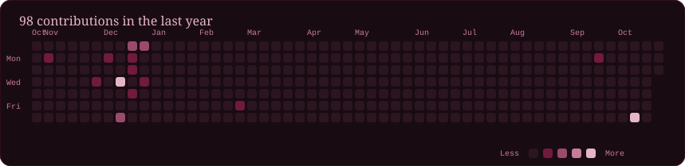

<picture>
  <source media="(prefers-reduced-motion: reduce)" srcset="assets/hero-static.svg">
  
</picture>

## About

I'm a mobile software engineer from Mansoura, Egypt. I build cross-platform apps with Flutter, BLoC/Cubit and Clean Architecture, and I take features from requirements through to store release. I've published apps to both Google Play and the Apple App Store.

- I resolved 20+ backlog issues across production Flutter apps, which reduced crash frequency.
- I integrated 5+ RESTful APIs (real-time chat, Google Maps, push notifications) using Dio, with response caching.
- I've handled the full release lifecycle: build configuration, app signing, store submission and deployment.

## Education and certifications

**B.Eng., Computer Systems Engineering** — Misr Higher Institute of Engineering and Technology, Mansoura, Egypt (Aug 2021 – Jul 2025)
Graduation project: **BrainPulse**, an AI-powered brain disorder diagnostic app, awarded graduation project distinction.

- Flutter & Dart: The Complete Guide — Udemy
- Master Git & GitHub — Udemy
- Web Development Fundamentals (HTML, CSS, JavaScript, Bootstrap, React) — New Horizons
- Backend Development (PHP, Laravel, MySQL) — New Horizons

## Experience

| Role | Company | Period |
| --- | --- | --- |
| Mobile Software Engineer | Moon Space Egypt | Jul 2024 – Aug 2026 |
| Mobile Software Engineer | Anmka Egypt | Oct 2025 – Dec 2025 |

## Selected projects

| Project | What it is | Stack | Links |
| --- | --- | --- | --- |
| **Al-Hafez** | Academy management platform with separate student and teacher interfaces, session calendar, analytics, subscriptions, PDF receipts, Arabic and English | Flutter, Firebase, BLoC | [Google Play](https://play.google.com/store/apps/details?id=com.technolanes.alhafiz) · [App Store](https://apps.apple.com/us/app/%D8%A7%D9%84%D8%AD%D8%A7%D9%81%D8%B8/id6757515415) · [Website](https://al-hafez.vercel.app/) |
| **Moaawn** | Home services marketplace with real-time order tracking and Paymob payments | Flutter, BLoC, Firebase, Paymob | [Google Play](https://play.google.com/store/apps/details?id=com.moafaa.moaawn) · [App Store](https://apps.apple.com/eg/app/%D9%85%D8%B9%D8%A7%D9%88%D9%86-moaawn/id6741809054) |
| **STP Academy** | Educational app built from scratch | Flutter, BLoC, Clean Architecture | [Google Play](https://play.google.com/store/apps/details?id=com.anmka.stpnew) · [App Store](https://apps.apple.com/eg/app/stp-academy/id6760566377) |
| **Albootcamp** | Contributed to an Arabic booking platform for collective learning | Flutter, Cubit, Supabase | [App Store](https://apps.apple.com/eg/app/albootcamp-%D8%A7%D9%84%D8%A8%D9%88%D8%AA-%D9%83%D8%A7%D9%85%D8%A8/id6758223539) |
| **Future** | App built from scratch, with the full release pipeline managed | Flutter, BLoC, Clean Architecture | [Google Play](https://play.google.com/store/apps/details?id=com.anmka.future) |
| **Efham** | Maintained and enhanced an existing app: bug fixes, new features, stability | Flutter, Dart | [Google Play](https://play.google.com/store/apps/details?id=com.anmka.efhamm) |
| **Techy** | Educational platform with mentor-student chat, video meetings and social feeds | Flutter, Firebase, BLoC | Google Play |
| **BrainPulse** | Doctor-facing app that gets diagnostic suggestions from a machine learning model via REST API | Flutter, REST API, ML | [GitHub](https://github.com/IbrahimElbazz/Brainpulse) |

## Skills

| Category | Technologies |
| --- | --- |
| Languages | Dart, Java, JavaScript, PHP, HTML, CSS |
| Frameworks | Flutter, Laravel, React |
| State management | BLoC, Cubit |
| Data and backend | Firebase, Supabase, MySQL, Hive |
| Architecture | Clean Architecture, MVVM, MVC, SOLID, Design Patterns, RESTful APIs |
| Tools | Git, GitHub, Android Studio, VS Code |

**Languages:** Arabic (native), English (advanced)

## GitHub activity

## Connect

- LinkedIn: [ibrahim-ahmed-403673377](https://linkedin.com/in/ibrahim-ahmed-403673377)
- GitHub: [IbrahimElbazz](https://github.com/IbrahimElbazz)
- Portfolio: [ibrahim-ahmed-elbaz.vercel.app](https://ibrahim-ahmed-elbaz.vercel.app/)
- Email: [ibrahim.elbaz.1011@gmail.com](mailto:ibrahim.elbaz.1011@gmail.com)

<picture>
  <source media="(prefers-reduced-motion: reduce)" srcset="assets/footer-static.svg">
  
</picture>
